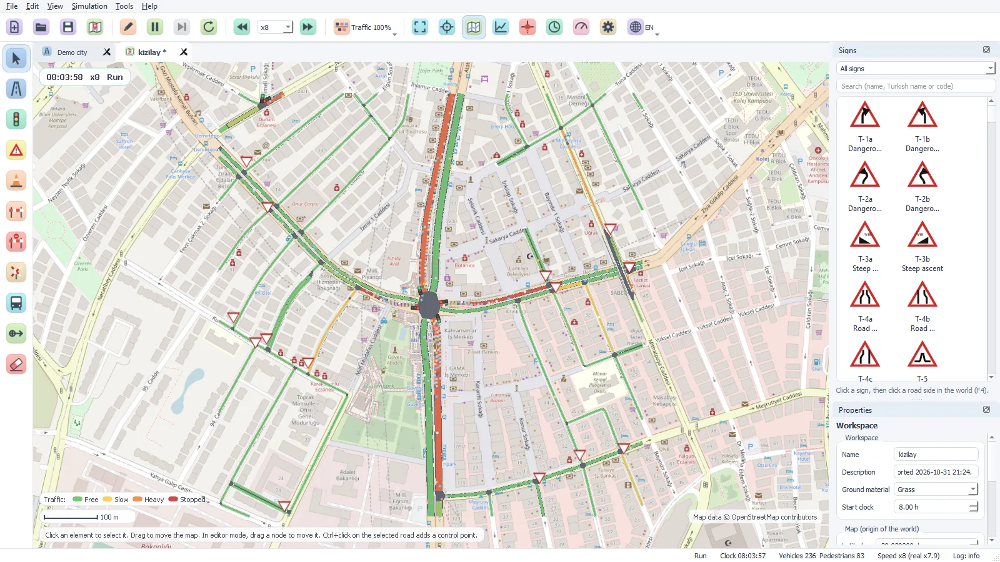
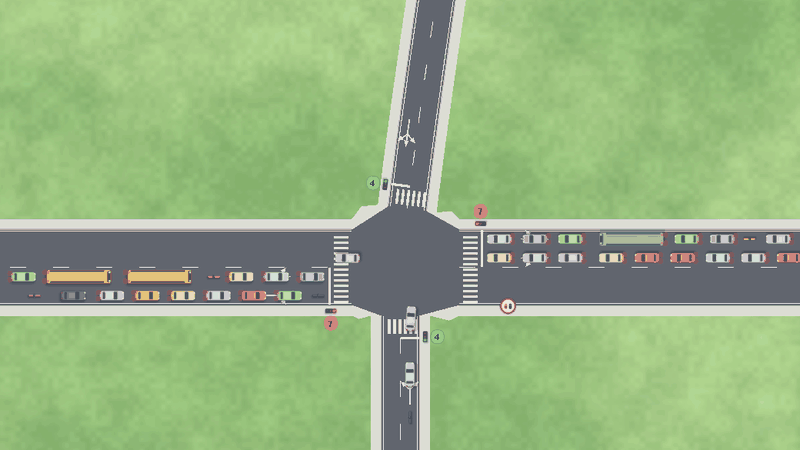
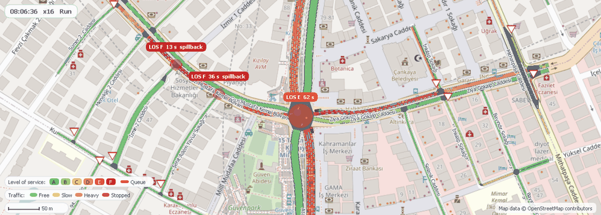

# Traffic Engine

Traffic Engine is a 2D traffic simulation program for Windows. It imports the roads of a real area
from OpenStreetMap and simulates each vehicle, traffic light and pedestrian. It shows the junctions
with congestion and tells you why the vehicles wait.

Test a change of the roads or the traffic lights in the simulation before you make it on the road.



## Main functions

### OpenStreetMap import with a live map

Find a place with its name, or draw the import area on a live map. Traffic Engine downloads the
data from the Overpass API and makes the road network:

- Lanes, junctions, traffic lights, stop signs and give way signs
- Bus stops, crosswalks, level crossings, bridges and tunnels
- Dual carriageways become two-way roads with a median

The program can show the map tiles below the roads. You can also open an `.osm` file.

### Junction rules

Each vehicle follows the vehicle in front of it (Intelligent Driver Model) and changes lanes when
necessary. A vehicle enters a junction only when it has a reservation for its path and the exit has
space for its full length. Thus, the vehicles do not block the junctions.

- Priority roads, stop signs, give way signs and lane rules
- Traffic lights with fixed times, actuated control or external control
- Pedestrians on the crosswalks, buses at the bus stops, motorcycles
- A fuel and CO₂ model for each type of vehicle
- Gridlock rule: a vehicle that waits at a full exit for half of the timeout gets a new route. At
  the timeout (default 180 s), the vehicle leaves the simulation.



*A junction with traffic lights. The numbers show the time to the next change of the light.*

### Congestion analysis

The congestion analysis (View > Congestion analysis, Ctrl+K) shows where the traffic stops. For
each junction, it calculates the delay per vehicle and the level of service (LOS A to F). The
limits of the levels come from the Highway Capacity Manual 2010 (HCM 2010).

- Queue bands and LOS circles on the map, labels at the worst junctions
- A list of the junctions, the worst junction first
- Delay, flow, queue length and the main cause of the waits at each junction
- Spillback: the queue fills the road back to the junction before it
- Click a junction in the list: the view goes to the junction.
- Export the list as a CSV file, or read it through the API.



*Kızılay, Ankara, at 200 % traffic density. The labels show the junctions with LOS F.*

### The cause of each wait

Select a vehicle. The State line of the property panel gives the cause of the wait. Examples are a
red light, a vehicle with priority, a full exit and pedestrians on the crosswalk. The text has a
link to the cause. Click the link: the view goes to that vehicle, traffic light, sign or object.

### Editor with 186 Turkish traffic signs

In the editor mode (Edit > Editor mode, Ctrl+E), the simulation stops. Draw roads and junctions
with the mouse. Put traffic lights, signs, cones, barriers and bus stops on the roads. The property
panel shows the values of the selected element. You can also change the values during the
simulation.

- 186 Turkish traffic signs with their official codes
- Traffic light programs: phases, green times, all-red times and coordination
- Workspaces in `.te` files (XML), more workspaces in tabs

### Charts

The charts show 16 values of the simulation in time. Examples are the mean speed, the stops, the
waits at the junctions, the fuel consumption and the CO₂ emission. Compare the results before and
after a change. Export the charts as PNG, SVG or CSV files.

### External API

The external API uses HTTP and JSON. Other programs can read the simulation state, the statistics,
the vehicles and the congestion analysis. They can also control the simulation. An external
traffic light controller can send the phases of the lights. To start the API server, select
Tools > Settings > API > Start the API server. Refer to [docs/api.md](docs/api.md).

### English and Turkish user interface

The user interface is in English and in Turkish. To change the language, select View > Language or
click the button on the toolbar. It is not necessary to start the program again.

## Build the program

### Necessary software

- Windows 10 or 11 (64-bit)
- Visual Studio 2022 or 2019 with the workload "Desktop development with C++"

The setup script finds these components on the computer. If a component is not there, the script
downloads it into `cots\`:

- CMake 3.16 or newer (the script also finds the CMake of Visual Studio)
- Qt 5.12 or newer (Qt 5, MSVC, 64-bit)
- Xerces-C 3.2 or newer
- Boost 1.70 or newer (headers only)
- 7-Zip

An internet connection is necessary only for a download. For the download of Qt (5.15.2, with
aqtinstall), Python is necessary. Refer to [cots/README.md](cots/README.md).

### Steps

1. Start `build\setup_cots.bat`. The script finds or downloads the third-party components and
   collects them in `cots\`.
2. Start `build\build_Release_x64.bat`. The script makes the project files with CMake and compiles
   the program.
3. Start `bin\Release\traffic_engine.exe`.

You can start the scripts with a double-click. In a command prompt, add the argument `nopause`.
Then the script does not wait for a key at the end:

```bat
build\setup_cots.bat nopause
build\build_Release_x64.bat nopause
bin\Release\traffic_engine.exe
```

- The build fills `bin\Release\`: a hard link to the program, symbolic links to the other files and
  the Qt files from windeployqt. If Windows does not let the build make symbolic links, the build
  copies the files. To get links, set the Developer Mode of Windows to On.
- `build\build_Debug_x64.bat` compiles the Debug version into `bin\Debug\`. `build\devenv.bat`
  opens the solution in Visual Studio. Push F5 to start the program with the debugger.
- `build\deploy_Release_x64.bat` makes the release package in `deploy\`: a folder and a 7z archive.
  If Inno Setup is available, the script also makes a setup file in `installer\Output\`.

## First steps

- Start the program. It opens the demo workspace.
- To run or pause the simulation, push the space bar. To change the speed, push + or -.
- To import a real area, select File > Import from OpenStreetMap (Ctrl+I). Draw the area on the
  map with Shift + drag. Then click Import.
- To find the congested junctions, select View > Congestion analysis (Ctrl+K).
- To see all the keys, select Help > Keys and mouse.

## Tests

The simulation test runs without a window and as fast as possible. It examines each step and
records these problems:

- vehicles that overlap
- vehicles that do not move for a long time
- loops of waits (deadlocks)
- incorrect reservation counts at the junctions

The test writes a report to `%APPDATA%\traffic_engine\log\sim_test.txt`. The exit code is 0 (no
problem), 1 (problems) or 2 (the test cannot start).

```bat
start /wait bin\Release\traffic_engine.exe --sim-test 3600 --sim-file tests\osm\kizilay.osm
echo %ERRORLEVEL%
```

`tests\sim_test_matrix.ps1` runs 15 tests: 5 networks with 3 seeds, and 2 hours of simulated time
for each test. Run it before and after each change of the traffic rules. The overlaps and the long
standstills must not increase. Refer to [tests/README.md](tests/README.md).

```powershell
powershell -ExecutionPolicy Bypass -File tests\sim_test_matrix.ps1 -Name before
```

## Configuration and logs

- The configuration is in `%APPDATA%\traffic_engine\config.xml`.
- The log files and the crash reports are in the `log` and `crash` folders of
  `%APPDATA%\traffic_engine\`. To open a folder, select Help > Open the log folder or Help > Open
  the crash folder.
- For the debug mode, start the program with `--debug`. The log then has all lines (level TRACE),
  and a crash makes a full memory dump.

## Web site

The promotion web site is in the `docs` folder: [docs/index.html](docs/index.html) and the files
in `docs/assets/`. To publish the site with GitHub Pages, do these steps:

1. On GitHub, open the repository.
2. Select Settings > Pages.
3. Set the source to "Deploy from a branch".
4. Select the branch `main` and the folder `/docs`.
5. Click Save.

The address of the site is `https://<user>.github.io/<repository>/`. For a local preview, start
`python -m http.server 8765 --directory docs` in the root folder of the repository. Then open
`http://127.0.0.1:8765/` in a browser.

## Map data

Map data and map tiles in the program and in the images:
© [OpenStreetMap contributors](https://www.openstreetmap.org/copyright) (ODbL). The extracts in
`tests/osm/` are OpenStreetMap data too.

The program uses public servers: the Overpass API, Nominatim and the tile server of
OpenStreetMap. Obey the usage policies of these servers. For repeated tests, open the last download
again: `%APPDATA%\traffic_engine\osm\last_download.osm`.

## Third-party components

| Component | Use in Traffic Engine | License |
|---|---|---|
| [Qt 5](https://www.qt.io/) | User interface, OpenGL view, network | GNU LGPL v3 |
| [Xerces-C](https://xerces.apache.org/xerces-c/) | All XML files (configuration, `.te` files) | Apache License 2.0 |
| [Boost](https://www.boost.org/) | Spatial index (R-tree), route graph | Boost Software License 1.0 |
| [7-Zip](https://www.7-zip.org/) | Compression of old log files | GNU LGPL (most parts) |

## License

The license of Traffic Engine is not selected yet.
